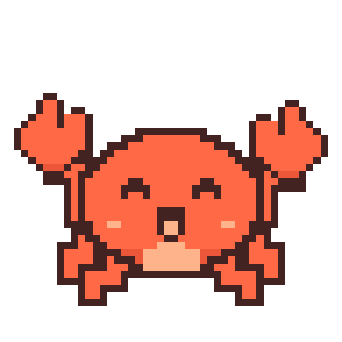
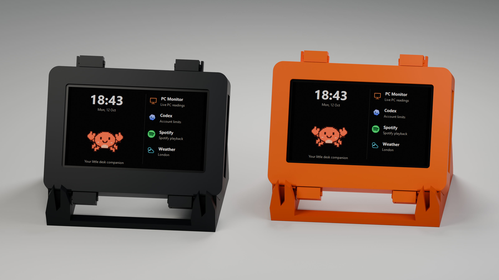

  

<h1 align="center">ClawPal</h1>

  A little company for your desk. 
  An animated pixel crab that shows PC stats, music controls, Codex and Claude Code usage,
  weather, a clock and a timer on a Wi-Fi touch display.

  
  
  

  <a href="https://github.com/Kaayoos/clawpal/releases/latest"><b>Download</b></a>
  &nbsp;·&nbsp;
  <a href="https://makerworld.com/en/models/3430625-esp32-clawpal-your-desk-pc-buddy-for-daily-use#profileId-3911176">3D-printable case</a>
  &nbsp;·&nbsp;
  <a href="#hardware">Supported boards</a>
  &nbsp;·&nbsp;
  <a href="docs/BUILDING.md">Build from source</a>
   
  Made by <a href="https://minimalpulse.com/">MinimalPulse</a>

  

## What it does

The crab lives on the Home screen next to a clock and shortcuts to your apps:

- Live PC stats, with optional in-game FPS
- Media, for whatever is playing: Spotify, Apple Music, TIDAL, browsers and any other app that shows up in Windows' media controls, with the album cover, seeking, shuffle, repeat and volume. Spotify keeps its own logo
- Codex and Claude Code usage gauges with reset countdowns, a pace forecast and recent tasks
- A full-screen alert on any app when Claude Code or Codex is waiting for your answer; **Show on PC** brings that window to the front
- Weather now, for the next 24 hours and for five days
- A clock and a timer with quick presets and an end time

Media, Codex and Claude Code can open their apps on the display automatically, or you can keep Home on screen. When you lock the PC or it goes to sleep, the crab naps instead of reporting the PC offline. Tap your crab for a hello.

  

## Hardware

Only the Waveshare 4.3B has been tested on real hardware. Its main features were exercised during development, but backup restore and wider Windows and hardware testing still need doing. The other boards are experimental: they may fail to boot, show an image, read touch or wake up. If you try one, please report your exact board revision.

| Board | Screen | Status |
| --- | --- | --- |
| Waveshare ESP32-S3-Touch-LCD-4.3B | 800 × 480 | Tested |
| Waveshare ESP32-S3-Touch-LCD-5 (standard 800 × 480 model) | 800 × 480 | Experimental |
| Waveshare ESP32-S3-Touch-LCD-7, 16 MB flash | 800 × 480 | Experimental |
| Waveshare ESP32-S3-Touch-LCD-7, 8 MB flash | 800 × 480 | Experimental |
| Waveshare ESP32-S3-Touch-LCD-2.8C | 480 × 480 | Experimental |
| Guition ESP32-4848S040C_I (capacitive touch) | 480 × 480 | Experimental |
| M5Stack CoreS3 | 320 × 240 | Experimental |

Pick the exact model printed on your board, not one with the same chip or screen size. The Waveshare 5B (1024 × 600), non-B 4.3-inch boards, resistive-touch Guition boards and M5Stack Core/Core2 are different hardware and aren't supported. For the 7-inch board, choose the flash size the installer's USB check reports. [Board profiles](boards/README.md) lists sources, revisions, layout behavior and recovery steps.

On square and smaller screens all apps still work. Content scrolls vertically above a fixed Apps/Home footer; swipe up for more Home shortcuts, forecast rows, task details or timer settings.

ClawPal has a ready-made 3D-printable case on [MakerWorld](https://makerworld.com/en/models/3430625-esp32-clawpal-your-desk-pc-buddy-for-daily-use#profileId-3911176).

## Install

Download `ClawPal-Setup.exe` from the [latest release](https://github.com/Kaayoos/clawpal/releases/latest). It bundles everything it needs, so you don't have to install Python, .NET, PresentMon or ESP-IDF.

1. Plug the display into your PC with a USB data cable.
2. Confirm the detected device and board model. Choose a 2.4 GHz Wi-Fi network, your location and time zone, and a language for the PC and one for the display.
3. Choose whether ClawPal starts with Windows, tracks game FPS and switches display apps automatically.
4. Leave **Save a full device backup** on and install. The 8 or 16 MB backup can take several minutes, so keep the cable connected.

Setup replaces the firmware on the board. The installer checks the chip, flash size and firmware before it writes anything, but USB can't tell which screen is wired to the chip, so confirming the board model matters. If the backup fails or can't be verified, installation stops.

The companion is a Windows x64 app. It installs per user, ships with its own runtime and isn't code signed. After setup it opens its settings window; when it starts with Windows it stays in the tray, and closing the window leaves it running there. Backups and settings live in `%USERPROFILE%\.clawpal`. Keep that folder private, because backups can contain network settings.

After the first install, settings and firmware updates go over Wi-Fi, and firmware updates keep your settings. The display asks you to tap **Allow** before it accepts a firmware update or Wi-Fi change from the PC. Changes made while the display is offline are sent when it reconnects. The PC can use Ethernet as long as it's on the same network. Backup and restore still use USB, and a future bootloader or partition change may too.

## Settings

In the companion you can:

- Reorder Home shortcuts and choose which apps appear
- Set English or Polish separately on the PC and the display
- Switch between 12- and 24-hour time and Celsius or Fahrenheit, and set your location and weather preferences
- Set idle dimming, brightness, night hours and the app shown while the PC is offline
- Turn on FPS tracking or Windows startup, or pause PC monitoring

CPU temperature appears when [LibreHardwareMonitor](https://github.com/LibreHardwareMonitor/LibreHardwareMonitor) is running, or HWiNFO with **Shared Memory Support** turned on. Windows has no standard CPU temperature sensor, and ClawPal doesn't install a driver to read one.

To remove ClawPal, use **Settings → Apps → Installed apps** in Windows, or run `ClawPal.Companion.exe --uninstall`. It closes the companion, removes its shortcuts and settings, disconnects Claude Code and asks whether to keep your display backups. The display keeps its firmware.

## Claude Code

Native Windows Claude Code sessions get their own display app, with usage windows, a keyboard crab and a list of recorded sessions.

To connect it, enable Claude Code under Apps, click **Companion → Connect / repair Claude Code**, then restart any Claude sessions that were already open. If you upgraded from an older version, add the Claude shortcut in Home settings.

ClawPal changes Claude Code's settings only when you click that button. It adds its own hooks, wraps your existing status line without losing its output, and saves a backup in `%USERPROFILE%/.clawpal/claude`. **Disconnect Claude Code** restores your original settings.

For current five-hour and weekly limits, enable **Companion → Live Claude limits** and save. This is off by default, including on upgrades. ClawPal uses your existing Desktop or native CLI sign-in to request limits and reset times from Anthropic, once per minute during active sessions. No chat messages are sent. This uses an undocumented endpoint also used by Claude Desktop, so future Anthropic changes can require a ClawPal update.

Without live access, the CLI reports usage through its status line after its first response on supported subscriptions. Desktop Code sessions use local plan-usage history, which can update slowly. Cached readings show their real age and expire after 30 minutes; stale Desktop history cannot replace newer status-line readings.

With live limits enabled, the existing access token is decoded in memory and sent only to `https://api.anthropic.com/api/oauth/usage`. ClawPal doesn't save or log it, send it to the display, or refresh it. It doesn't read cookies or conversation transcripts. Prompts and tool arguments from hook input are discarded. Task and project folder names travel only over your paired local connection. WSL and remote sessions aren't supported; activity tracking covers Code sessions rather than regular Desktop chats. See [Claude Code integration](docs/CLAUDE.md) for the details.

## Privacy

The PC and the display talk over your local network using plain HTTP. Every request is signed with your pairing key, which itself never crosses the network, so another device on the LAN can't send commands or replay old ones. The traffic isn't encrypted, though, so keep the display on a network you trust. Wi-Fi firmware updates must be signed by the ClawPal release key; your own builds still install over USB.

Your location coordinates go to Open-Meteo for forecasts (location search uses its geocoding API too), and update checks contact GitHub. If you enable Live Claude limits, ClawPal sends an authenticated usage request to Anthropic. Codex data comes from your local Codex installation and may stop working if Codex changes. Music controls use Windows' local media session and the player's own entry in the Windows volume mixer, so system volume is never changed. The album cover is shrunk to 160 × 160 pixels on the PC and sent only to your paired display, which keeps the current one in memory.

FPS tracking is optional. It uses the bundled Intel PresentMon console helper and Windows ETW events, and it doesn't modify games or inject an overlay. Results and overhead depend on the game and your Windows permissions; when FPS isn't available, the field stays blank. There's no promise about how any game's anti-cheat treats it.

Don't publish your pairing token, network passwords, local logs or device backups. [Architecture](docs/ARCHITECTURE.md) covers how all of this works.

## Building from source

You need ESP-IDF 5.5.2, .NET SDK 8.0.425 and Python 3.12. Firmware binaries and downloaded tools aren't kept in Git. Run `./scripts/release.ps1 -Publish` to push a release tag; GitHub Actions then builds, tests and signs it and publishes the release once you approve the signing step. See the release guide for toolchain setup and recovery.

- [Build instructions](docs/BUILDING.md)
- [Release format and publishing](docs/UPDATES.md)
- [Translations](languages/README.md)
- [Screen and weather settings](docs/SCREEN-AND-WEATHER.md)
- [Contributing](CONTRIBUTING.md)

## License and credits

ClawPal's code, documentation and crab artwork are GPLv3. The firmware has an [ESP-IDF linking permission](LICENSES/ESP-IDF-exception.txt) and the companion a [Windows SDK linking permission](LICENSES/Windows-SDK-exception.txt). You can fork and rename ClawPal under the license, as long as you keep the copyright and license notices and supply the source when the license requires it. See [LICENSE](LICENSE), [NOTICE](NOTICE), the [branding policy](TRADEMARKS.md) and [third-party credits](THIRD_PARTY_NOTICES.md). Credits and licenses are also in the companion (click the version label) and on the display (hold the version text on Home).

PresentMon is MIT licensed. Weather data comes from [Open-Meteo](https://open-meteo.com/) under [CC BY 4.0](https://creativecommons.org/licenses/by/4.0/), with GeoNames location data. Forecast values are summarized, rounded and optionally converted to Fahrenheit. Open-Meteo's free hosted API has its own noncommercial-use terms.

The official source and updates are at [Kaayoos/clawpal](https://github.com/Kaayoos/clawpal). ClawPal is independent of Spotify, OpenAI, Anthropic, Intel, Espressif and Waveshare. Spotify, OpenAI/Codex and Anthropic/Claude marks belong to their owners and keep their own brand terms.
