

  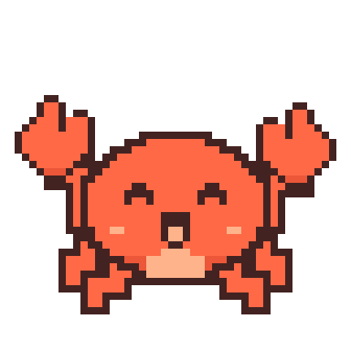

<h1 align="center">ClawPal</h1>

  A little company for your desk. 
  An animated pixel crab that shows PC stats, music controls, a volume mixer, Codex and Claude Code
  usage, weather, a clock and a timer on a Wi-Fi touch display.

  
  <a href="https://makerworld.com/en/models/3546648-esp32-s3-pc-monitor-spotify-weather-desk-buddy#profileId-4057099">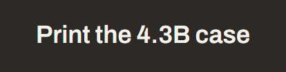</a>
  

  
  
  
   
  Made by <a href="https://minimalpulse.com/">MinimalPulse</a> · <a href="https://github.com/Kaayoos/clawpal/releases/latest">Release notes</a> · <a href="docs/BUILDING.md">Build from source</a>

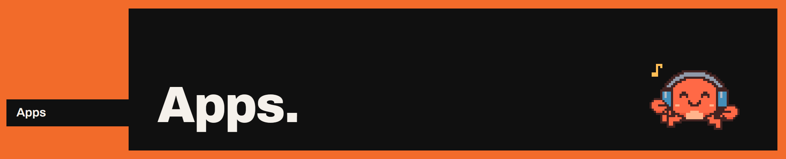

All on the display's touch screen, a tap apart. Turn off the ones you don't need in the PC app and keep your five favourites on Home with the crab. Media, Codex and Claude Code can open their apps on the display automatically, or you can keep Home on screen. Tap your crab for a hello.

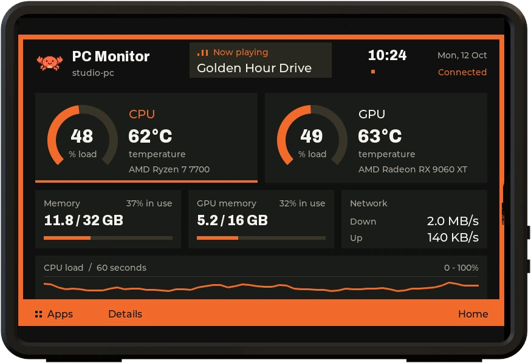

###  PC Monitor

CPU and GPU load and temperature, memory, network and a 60-second chart, readable from across the desk. Start a game and it can show your FPS too.

CPU temperature appears when LibreHardwareMonitor or HWiNFO is running.

 

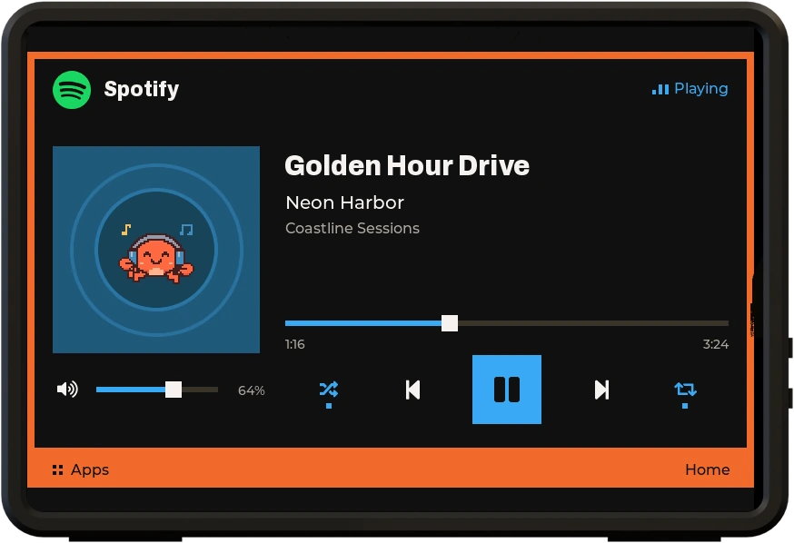

###  Media

Whatever is playing on your PC, with its cover: Spotify, Apple Music, TIDAL, your browser or any app in Windows' media controls. Pause, skip, seek, shuffle, repeat and set its volume without leaving what you're doing. Spotify keeps its own logo.

There's a mixer too: a fader and a mute for your speakers, your microphone and every app playing sound, each app with its own icon.

Turn on synced lyrics in the PC app and a Lyrics button shows each line as it's sung. Lyrics come from [LRCLIB](https://lrclib.net/), a free community lyrics database.

 

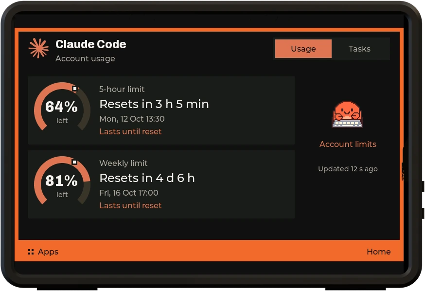

###  Claude Code and Codex

Your five-hour and weekly limits with reset countdowns, a pace forecast and your recent tasks. The crab types along while they work.

Claude Code connects from the PC app with one click, and disconnects just as easily. <a href="#claude-code">How it connects</a>

 

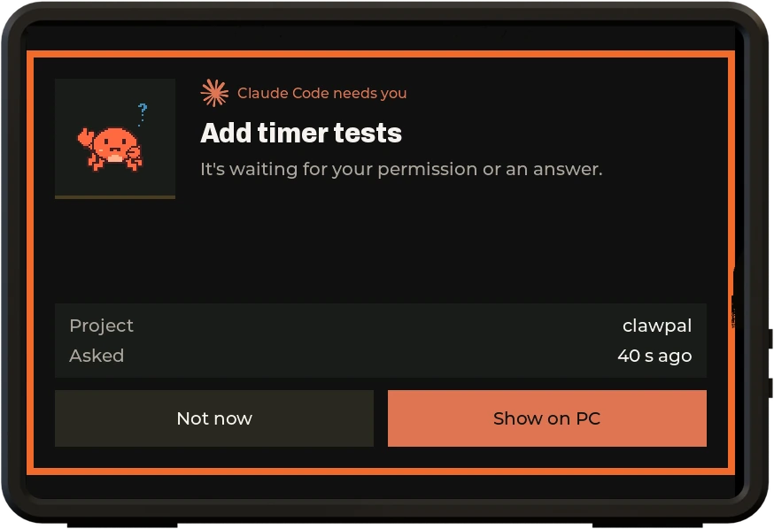

###  When it needs you

When Claude Code or Codex is waiting for your answer, the whole display says so, whatever app is open. **Show on PC** brings that window to the front.

 

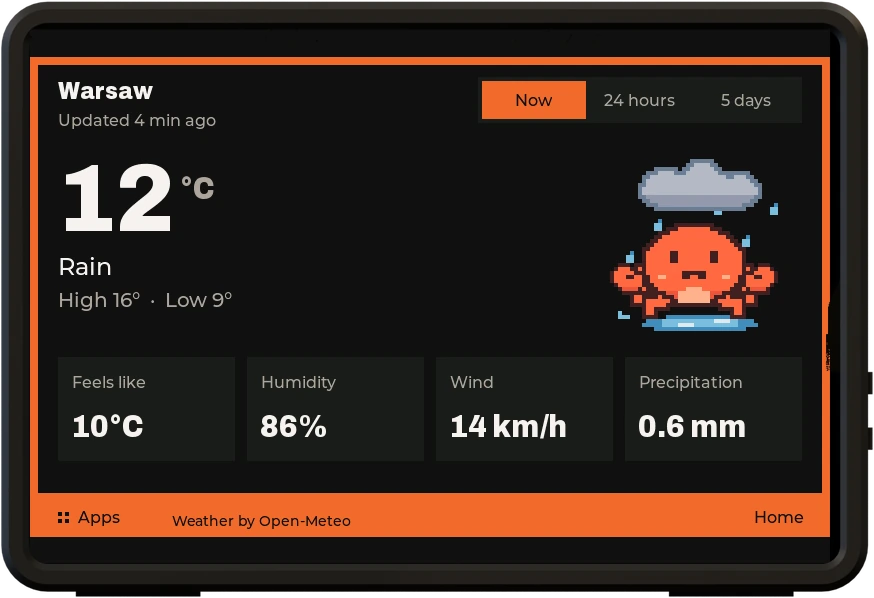

###  Weather

Now, the next 24 hours and five days for your city, from Open-Meteo. The crab dresses for it: sun, clouds, rain or a clear night.

 

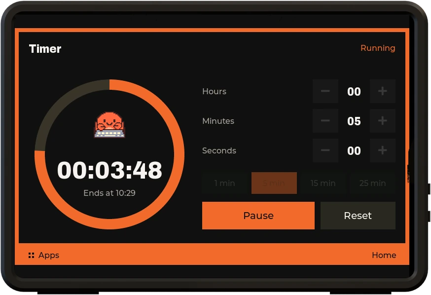

###  Clock and timer

A calm clock with the weather beneath it, and a countdown with quick presets that tells you when it will end.

When you lock the PC or it goes to sleep, the crab naps instead of reporting the PC offline.

 

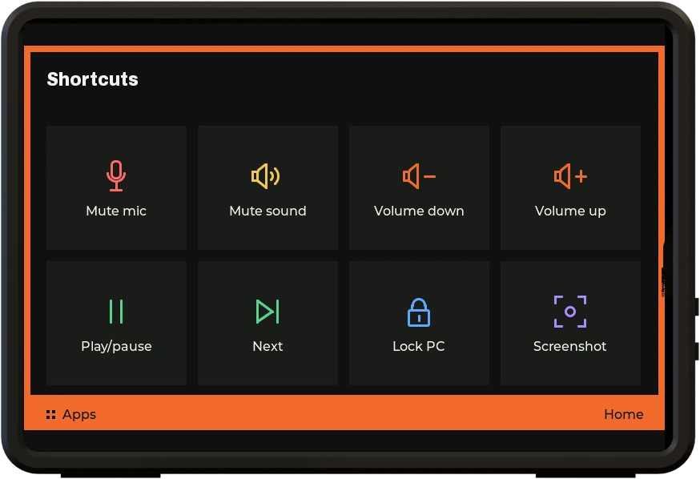

###  Shortcuts

Tiles that run things on your PC: mute the mic or the sound, change the volume, control media, lock the PC, turn the screens off, take a screenshot, open an app, a site or a folder, or press a key combination.

Build a deck of 6, 8, 12 or 16 tiles in the PC app. Mute tiles light up while muted, and app tiles show the app's own icon.

 

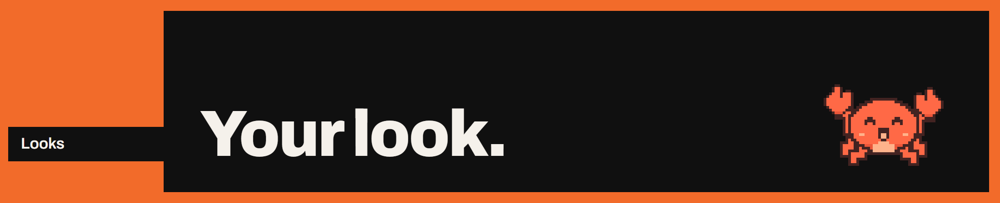

The display comes in four looks. Pick one in the PC app and switch whenever you like; the app itself keeps its own orange.

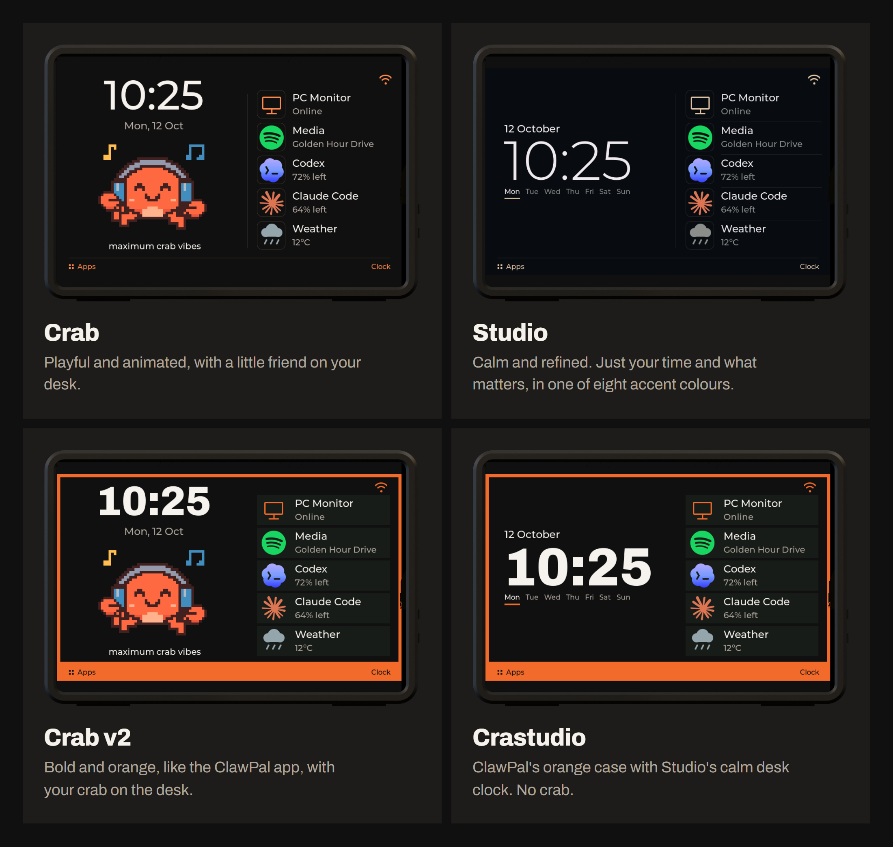

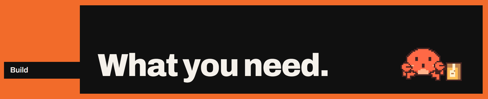

###  A board

Nine boards, three of them tested on real hardware. Pick the exact model printed on your board, not one with the same chip or screen size.

| | Board | Screen | Status |
| :---: | --- | --- | --- |
| 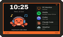 | **Waveshare ESP32-S3-Touch-LCD-4.3B** The board ClawPal is made on, and the only one the cases fit. | 800 × 480 | **Tested** |
|  | **[Waveshare ESP32-S3-Touch-LCD-4.3](https://www.waveshare.com/esp32-s3-touch-lcd-4.3.htm)** The 4.3 without the B. Choose the 4.3B in the installer. | 800 × 480 | **Tested** |
| 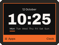 | **LCDWIKI 2.8-inch ESP32-S3 Display (ES3C28P)** Capacitive touch. Apps scroll above a fixed Apps and Home footer. | 320 × 240 | **Tested** |
|  | **Waveshare ESP32-S3-Touch-LCD-5** The standard 800 × 480 model. The 5B is different hardware. | 800 × 480 | Experimental |
|  | **Waveshare ESP32-S3-Touch-LCD-7, 16 MB flash** Choose the flash size the installer's USB check reports. | 800 × 480 | Experimental |
|  | **Waveshare ESP32-S3-Touch-LCD-7, 8 MB flash** The same screen with half the flash. | 800 × 480 | Experimental |
| 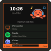 | **Waveshare ESP32-S3-Touch-LCD-2.8C** A square screen: content scrolls above the footer. | 480 × 480 | Experimental |
|  | **Guition ESP32-4848S040C_I** The capacitive-touch version only. | 480 × 480 | Experimental |
|  | **M5Stack CoreS3** The CoreS3 only; the Core and Core2 aren't supported. | 320 × 240 | Experimental |

The experimental boards may fail to boot, show an image, read touch or wake up. If you try one, please report your exact board revision. Backup restore and wider Windows testing still need doing too. The Waveshare 5B (1024 × 600), resistive-touch Guition boards and the touchless ES3N28P are different hardware and aren't supported. [Board profiles](boards/README.md) lists sources, revisions, layout behaviour and recovery steps.

On square and smaller screens every app still works. Content scrolls above a fixed Apps and Home footer; swipe up for more Home shortcuts, forecast rows, task details or timer settings.

###  A case, for the 4.3B only

Two designs, free on MakerWorld.

> [!WARNING]
> **Both cases fit only the Waveshare ESP32-S3-Touch-LCD-4.3B, without battery.** ClawPal runs on the other boards above, but they need a case of their own.

| | Case | |
| :---: | --- | --- |
| <a href="https://makerworld.com/en/models/3546648-esp32-s3-pc-monitor-spotify-weather-desk-buddy#profileId-4057099">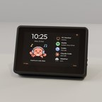</a> | **[Slim case](https://makerworld.com/en/models/3546648-esp32-s3-pc-monitor-spotify-weather-desk-buddy#profileId-4057099)** The newer design: a slim frame with a stand. About three hours to print. | Free on MakerWorld **Waveshare 4.3B only** |
| <a href="https://makerworld.com/en/models/3430625-esp32-clawpal-your-desk-pc-buddy-for-daily-use#profileId-3911176">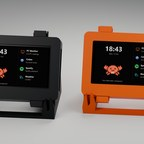</a> | **[Original case](https://makerworld.com/en/models/3430625-esp32-clawpal-your-desk-pc-buddy-for-daily-use#profileId-3911176)** The first design, on its own printed stand. About 3.6 hours and 108 g of PLA on one plate. | Free on MakerWorld **Waveshare 4.3B only** |

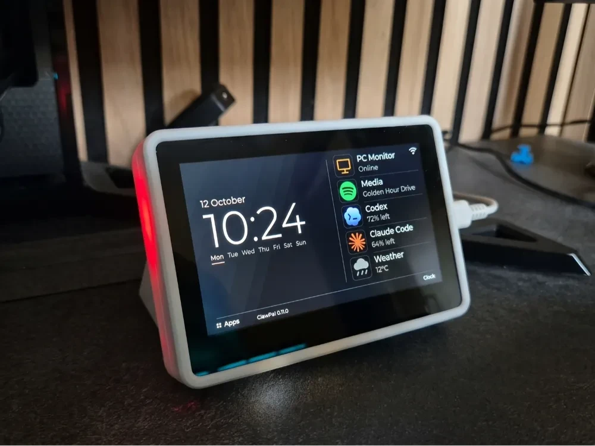

###  And

- **A USB data cable.** For the first install; a charge-only cable won't do.
- **A Windows x64 PC.** The companion runs there and sends the display its readings.
- **2.4 GHz Wi-Fi.** The display joins it, and later updates arrive over it.

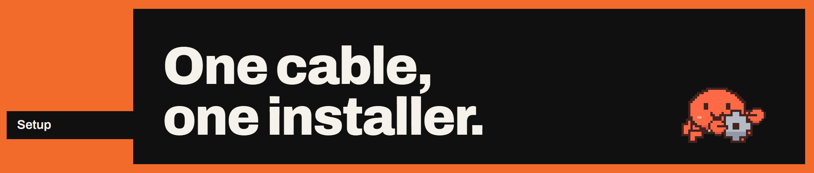

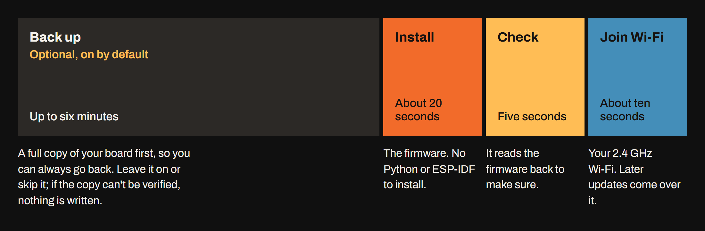

Download `ClawPal-Setup.exe` from the [latest release](https://github.com/Kaayoos/clawpal/releases/latest). It bundles everything it needs, so you don't have to install Python, .NET, PresentMon or ESP-IDF.

1. Plug the display into your PC with a USB data cable.
2. Confirm the detected device and board model. Choose a 2.4 GHz Wi-Fi network, your location and time zone, and a language for the PC and one for the display.
3. Choose whether ClawPal starts with Windows, tracks game FPS and switches display apps automatically.
4. Choose whether to **Save a full device backup** first. It's optional and on by default. The 8 or 16 MB backup can take several minutes, so keep the cable connected. Then install.

Setup replaces the firmware on the board. The installer checks the chip, flash size and firmware before it writes anything, but USB can't tell which screen is wired to the chip, so confirming the board model matters. If the backup fails or can't be verified, installation stops.

The companion is a Windows x64 app. It installs per user, ships with its own runtime and isn't code signed. After setup it opens its settings window; when it starts with Windows it stays in the tray, and closing the window leaves it running there. Backups and settings live in `%USERPROFILE%\.clawpal`. Keep that folder private, because backups can contain network settings.

After the first install, settings and firmware updates go over Wi-Fi, and firmware updates keep your settings. The display asks you to tap **Allow** before it accepts a firmware update or Wi-Fi change from the PC. Changes made while the display is offline are sent when it reconnects. The PC can use Ethernet as long as it's on the same network. Backup and restore still use USB, and a future bootloader or partition change may too.

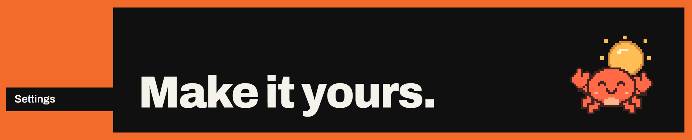

In the companion you can:

- Reorder Home shortcuts, choose which apps appear, and show the ClawPal version at the bottom of Home
- Pick the display's look: Crab, Studio, Crab v2 or Crastudio
- Set English or Polish separately on the PC and the display
- Switch between 12- and 24-hour time and Celsius or Fahrenheit, and set your location and weather preferences
- Set idle dimming, brightness, night hours and the app shown while the PC is offline
- Turn on FPS tracking or Windows startup, or pause PC monitoring
- Build your Shortcuts deck: choose a 6, 8, 12 or 16-tile grid, drag tiles around, and set each tile's action, label, icon and colour

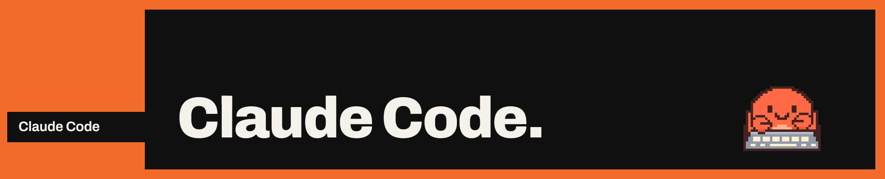

Native Windows Claude Code sessions get their own display app, with usage windows, a keyboard crab and a list of recorded sessions.

To connect it, enable Claude Code under Apps, click **Companion → Connect / repair Claude Code**, then restart any Claude sessions that were already open. If you upgraded from an older version, add the Claude shortcut in Home settings.

ClawPal changes Claude Code's settings only when you click that button. It adds its own hooks, wraps your existing status line without losing its output, and saves a backup in `%USERPROFILE%/.clawpal/claude`. **Disconnect Claude Code** restores your original settings.

For current five-hour and weekly limits, enable **Companion → Live Claude limits** and save. This is off by default, including on upgrades. ClawPal uses your existing Desktop or native CLI sign-in to request limits and reset times from Anthropic, once per minute during active sessions. No chat messages are sent. This uses an undocumented endpoint also used by Claude Desktop, so future Anthropic changes can require a ClawPal update.

Without live access, the CLI reports usage through its status line after its first response on supported subscriptions. Desktop Code sessions use local plan-usage history, which can update slowly. Cached readings show their real age and expire after 30 minutes; stale Desktop history cannot replace newer status-line readings.

With live limits enabled, the existing access token is decoded in memory and sent only to `https://api.anthropic.com/api/oauth/usage`. ClawPal doesn't save or log it, send it to the display, or refresh it. It doesn't read cookies or conversation transcripts. Prompts and tool arguments from hook input are discarded. Task and project folder names travel only over your paired local connection. WSL and remote sessions aren't supported; activity tracking covers Code sessions rather than regular Desktop chats. See [Claude Code integration](docs/CLAUDE.md) for the details.

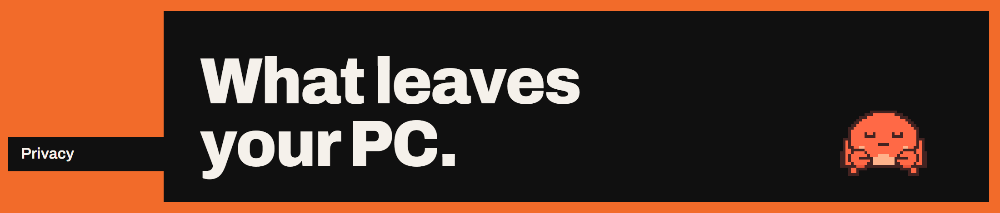

The PC and the display talk over your local network using plain HTTP. Every request is signed with your pairing key, which itself never crosses the network, so another device on the LAN can't send commands or replay old ones. The traffic isn't encrypted, though, so keep the display on a network you trust. Wi-Fi firmware updates must be signed by the ClawPal release key; your own builds need their own signing key (see [Build from source](docs/BUILDING.md)).

**What goes out**

- **Open-Meteo** gets your location coordinates for forecasts, and location search uses its geocoding API too.
- **GitHub** gets update checks.
- **Anthropic** gets an authenticated usage request, only if you enable Live Claude limits.
- **LRCLIB** gets the title, artist, album and length of each song you play, only if you turn on synced lyrics. Lyrics are kept on your PC, so each song is looked up once.

**What stays between your PC and the display**

- Codex data comes from your local Codex installation and may stop working if Codex changes.
- Music controls use Windows' local media session and the player's own entry in the Windows volume mixer, so the Media app never changes system volume.
- Shortcuts tiles do change system volume, mute and the microphone, but only the ones you add. What a tile runs stays on your PC; the display only receives its label, icon and colour, and a tap sends back only which tile it was. While the PC is locked, only sound, media, lock and screens-off tiles run.
- The Audio app changes the same volumes and mutes as the Windows volume mixer, for the output, the microphone and each app. The display receives each app's name and icon, and a move sends back only which channel and the new level.
- The album cover is shrunk to 160 × 160 pixels on the PC and sent only to your paired display, which keeps the current one in memory.

Don't publish your pairing token, network passwords, local logs or device backups. [Architecture](docs/ARCHITECTURE.md) covers how all of this works, and the [protocol reference](docs/PROTOCOL.md) lists every message.

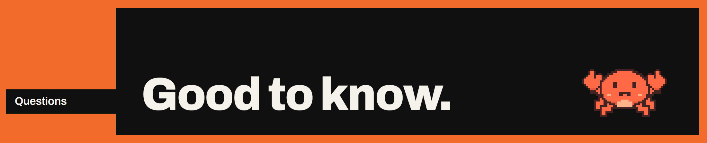

<b>Which board should I get?</b>

 

The Waveshare ESP32-S3-Touch-LCD-4.3B. ClawPal is made on it, and it's the only board the MakerWorld cases fit. The 4.3 without the B and the LCDWIKI ES3C28P also work on real hardware; the rest are experimental.

<b>Does it work on a Mac or Linux?</b>

 

No. The companion that reads your PC and sets up the display is a Windows x64 app.

<b>What does it cost?</b>

 

ClawPal is free and open source under GPLv3, and both cases are free on MakerWorld (for the 4.3B). You buy the board, print a case and use a USB data cable you probably have already.

<b>Why is my CPU temperature blank?</b>

 

CPU temperature appears when [LibreHardwareMonitor](https://github.com/LibreHardwareMonitor/LibreHardwareMonitor) is running, or HWiNFO with **Shared Memory Support** turned on. Windows has no standard CPU temperature sensor, and ClawPal doesn't install a driver to read one.

<b>Will FPS tracking upset anti-cheat?</b>

 

FPS tracking is optional. It uses the bundled Intel PresentMon console helper and Windows ETW events, and it doesn't modify games or inject an overlay. Results and overhead depend on the game and your Windows permissions; when FPS isn't available, the field stays blank. There's no promise about how any game's anti-cheat treats it.

<b>Can I go back to the board's old firmware?</b>

 

If you leave **Save a full device backup** on, setup copies the whole board before it writes anything, and stops if the copy fails or can't be verified. Backups are kept in `%USERPROFILE%\.clawpal`; restoring one uses USB.

<b>How do I remove ClawPal?</b>

 

Use **Settings → Apps → Installed apps** in Windows, or run `ClawPal.Companion.exe --uninstall`. It closes the companion, removes its shortcuts and settings, disconnects Claude Code and asks whether to keep your display backups. The display keeps its firmware.

<b>Where do I ask for help?</b>

 

On [Discord](https://discord.com/invite/gR5DqCdGre), or open an [issue](https://github.com/Kaayoos/clawpal/issues). If it's about a board, include its exact revision.

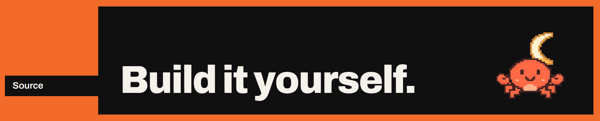

You need ESP-IDF 5.5.2, .NET SDK 8.0.425 and Python 3.12. Firmware binaries and downloaded tools aren't kept in Git. Run `./scripts/release.ps1 -Publish` to push a release tag; GitHub Actions then builds, tests and signs it and publishes the release once you approve the signing step. See the release guide for toolchain setup and recovery.

- [Build instructions](docs/BUILDING.md)
- [Release format and publishing](docs/UPDATES.md)
- [Translations](languages/README.md)
- [Screen and weather settings](docs/SCREEN-AND-WEATHER.md)
- [Display and PC app protocol](docs/PROTOCOL.md), for hardware mods
- [Contributing](CONTRIBUTING.md)

<a href="https://github.com/Kaayoos/clawpal/releases/latest">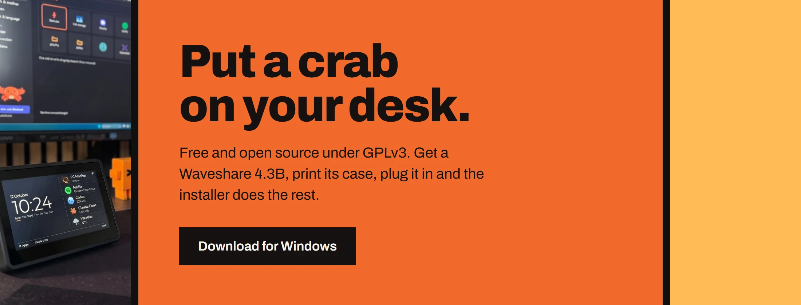</a>

  <a href="https://github.com/Kaayoos/clawpal/releases/latest/download/ClawPal-Setup.exe"><b>Download for Windows</b></a>
  &nbsp;·&nbsp;
  <a href="https://makerworld.com/en/models/3546648-esp32-s3-pc-monitor-spotify-weather-desk-buddy#profileId-4057099">Slim case, 4.3B only</a>
  &nbsp;·&nbsp;
  <a href="https://makerworld.com/en/models/3430625-esp32-clawpal-your-desk-pc-buddy-for-daily-use#profileId-3911176">Original case, 4.3B only</a>
  &nbsp;·&nbsp;
  <a href="https://discord.com/invite/gR5DqCdGre">Discord</a>

<b>Made by <a href="https://minimalpulse.com/">MinimalPulse</a>.</b> Pixel crab by MinimalPulse too, every frame of it.

ClawPal's code, documentation and crab artwork are GPLv3. The firmware has an <a href="LICENSES/ESP-IDF-exception.txt">ESP-IDF linking permission</a> and the companion a <a href="LICENSES/Windows-SDK-exception.txt">Windows SDK linking permission</a>. You can fork and rename ClawPal under the license, as long as you keep the copyright and license notices and supply the source when the license requires it. See <a href="LICENSE">LICENSE</a>, <a href="NOTICE">NOTICE</a>, the <a href="TRADEMARKS.md">branding policy</a> and <a href="THIRD_PARTY_NOTICES.md">third-party credits</a>. Credits and licenses are also in the companion (click the version label) and on the display (hold the version text on Home).

PresentMon is MIT licensed. Weather data comes from <a href="https://open-meteo.com/">Open-Meteo</a> under <a href="https://creativecommons.org/licenses/by/4.0/">CC BY 4.0</a>, with GeoNames location data. Forecast values are summarized, rounded and optionally converted to Fahrenheit. Open-Meteo's free hosted API has its own noncommercial-use terms. Set in Archivo (SIL Open Font License).

The official source and updates are at <a href="https://github.com/Kaayoos/clawpal">Kaayoos/clawpal</a>. ClawPal is independent of Spotify, OpenAI, Anthropic, Intel, Espressif and Waveshare. Spotify, OpenAI/Codex and Anthropic/Claude marks belong to their owners and keep their own brand terms.

